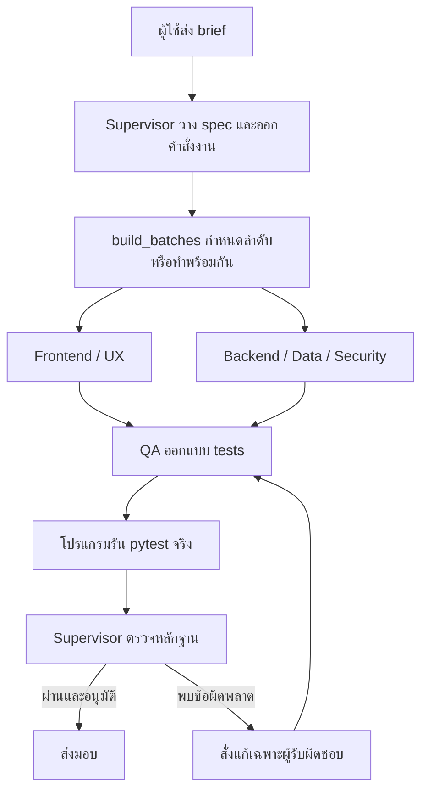

# Supervisor-led Software Engineering Team

สั่งงานผ่าน **Supervisor Agent ตัวเดียว** หัวหน้าจะวางข้อกำหนด แบ่งงานให้ Frontend,
Backend และ QA แล้วตรวจรับผล ระบบใช้ **Google Antigravity CLI (`agy`) บนเครื่อง** เป็นค่าเริ่มต้น
และยังเก็บตัวเชื่อม **Codex CLI** ไว้ให้เลือกเองได้ตามต้องการ
ใช้ CrewAI Flow จัดลำดับงาน ไม่ต้องใช้ SWU API token และไม่เปลี่ยนเป็น Gemini API key

## เปิด Agent Office (แนะนำ)

Office เป็นหน้าเว็บบนเครื่องสำหรับคุยกับหัวหน้าในโปรเจกต์เดิม ดูทีมรับงาน
เปิดเว็บที่สร้าง และตรวจประวัติการแก้ไข โดยใช้ Google Antigravity หรือ Codex ที่ล็อกอินไว้แล้ว

```sh
cd /Users/neutrino/Desktop/code/SW_BurntToCrisp/CPE320_BurntToCrisp
PYTHONPATH=src .venv/bin/python -m se_team.office
```

บน macOS ดับเบิลคลิก `start-office.command` ใน Finder เพื่อเปิดครั้งต่อไปได้ด้วย

เปิด [http://127.0.0.1:8787](http://127.0.0.1:8787) แล้วทำดังนี้:

1. สร้างโปรเจกต์ ตั้งชื่อและเล่าไอเดีย
2. ส่งคำสั่งในแชตหัวหน้า เช่น “เริ่มสร้างตามโจทย์นี้”
3. ดูสถานะจริงของทีมใน Agent office และเปิดผลลัพธ์ใน “เว็บของคุณ”
4. ส่งคำสั่งแก้ในแชตเดิม เช่น “เปลี่ยนสีและเพิ่มปุ่มบันทึก”
5. กด “ไฟล์เว็บ & บันทึกงาน” เพื่อเปิดโฟลเดอร์ ดูไฟล์ปัจจุบัน และสรุปงาน

คำสั่งที่ส่งระหว่างทีมทำงานจะเข้าคิวและทำตามลำดับ ปุ่มหยุดงานหยุดคำสั่งปัจจุบัน
และยกเลิกคำสั่งที่ยังรออยู่ บันทึกงานและไฟล์ปัจจุบันยังอยู่ ไฟล์ที่เขียนแล้วจะไม่ย้อนกลับอัตโนมัติ
หากผู้ให้บริการ (Antigravity หรือ Codex) แจ้งข้อจำกัดการใช้งาน Office จะพักคิว พร้อมปุ่มตรวจการเชื่อมต่ออีกครั้ง
การตรวจสถานะไม่เริ่มงานโมเดลและไม่ซื้อเครดิต เมื่อกลับมาใช้ได้ คิวที่เก็บไว้จึงทำต่อ
ระบบจะไม่สลับผู้ให้บริการกลับอัตโนมัติโดยไม่แจ้ง
ถ้า Office ปิดกลางงาน คำสั่งนั้นจะถูกระบุว่าขัดจังหวะและสามารถส่งใหม่ได้
โปรแกรมประมวลผลทีละคำสั่ง ส่วนงาน Frontend/Backend ภายในคำสั่งเดียวกันทำพร้อมกันได้

สถานะและการเคลื่อนที่ของตัวละครอ้างอิงการเริ่ม/จบงานของ Agent การเขียนไฟล์
และผล pytest จริง ไม่สุ่มงานเพื่อแสดงผล ไม่มีการเก็บข้อความเหตุผลภายในของโมเดล
หัวหน้าได้รับ spec ล่าสุด ไฟล์เดิม และบทสนทนาช่วงล่าสุดประกอบคำสั่งทุกครั้ง
ความต่อเนื่องมาจากข้อมูลโปรเจกต์ที่เก็บไว้ ไม่ได้อาศัยให้โปรเซสโมเดลเปิดค้างตลอดเวลา

ประวัติบันทึกถาวรที่ `workspace/office/office.sqlite3`
เว็บแต่ละโปรเจกต์อยู่ในโฟลเดอร์อ่านง่ายใกล้ราก เช่น `websites/BurningUpp/`
ทุกคำสั่งแก้ไฟล์ในโฟลเดอร์เดิม ไม่สร้างสำเนาเว็บหรือโฟลเดอร์รอบใหม่

```text
websites/BurningUpp/
├── frontend/       หน้าเว็บ
├── backend/        ระบบข้อมูล
├── tests/          ชุดทดสอบปัจจุบัน
├── data/           ข้อมูลที่ใช้จริง
└── preview.log     ข้อความจากการเปิดเว็บครั้งล่าสุด
```

Office เก็บแชต คำสั่ง รายชื่อไฟล์ที่เปลี่ยน จำนวนบรรทัด และผลตรวจแบบสั้น
ไม่เก็บโค้ดหรือผลทดสอบเต็มย้อนหลัง จึงเปิดหรือย้อนเว็บเวอร์ชันเก่าจาก log ไม่ได้
หากงานล้มเหลว ไฟล์ที่แก้ไปแล้วจะยังอยู่ในโฟลเดอร์หลัก ให้สั่งหัวหน้าทำต่อได้
Backend ใช้ `APP_DATA_DIR` ที่ชี้มายัง `data/` ส่วน QA ใช้ข้อมูลชั่วคราวแยกกัน
เมื่อเปิด Office ที่มีข้อมูลแบบเก่า ระบบจะย้ายเว็บล่าสุดกับข้อมูลเดิม
ตรวจว่าไฟล์ตรงกัน แล้วลบสำเนาเว็บเก่า พร้อมย่อบันทึกเดิมให้สั้นลง

เว็บพรีวิวรันในอีกโปรเซสบนอีกพอร์ตหนึ่ง ป้องกันการใช้ origin เดียวกับ Office
เปิดพรีวิวได้ครั้งละหนึ่งโปรเจกต์ และพักพรีวิวขณะทีมแก้ไฟล์
Office เปิดรับเฉพาะ localhost มีการตรวจ origin และ token สำหรับคำสั่งเปลี่ยนแปลงข้อมูล
ยังไม่มีระบบผู้ใช้หลายคนสำหรับ Office หรือการเผยแพร่ Office ขึ้นอินเทอร์เน็ต

ตัวเลือก: `--port 8788`, `--workspace <folder>`, `--max-rounds 2`
เก็บหน้าต่างที่รัน Office ไว้ระหว่างทีมทำงาน ใช้ Ctrl+C เพื่อปิด
สั่ง Office ใหม่ด้วยคำสั่งเดิมเมื่อกลับมาใช้งาน ประวัติจะยังอยู่

## การทำงานให้เร็วขึ้น

คำสั่งใหม่ใช้แผนแก้เฉพาะจุดสำหรับเว็บที่มีอยู่ หัวหน้าไม่ต้องเขียน spec ทั้งชุดซ้ำ
ลูกทีมได้รับเฉพาะไฟล์ที่เกี่ยวข้องและเสนอแก้เฉพาะข้อความที่เปลี่ยน ระบบตรวจข้อความเดิมก่อนเขียน
งานเปลี่ยนสีหรือข้อความใช้ชุดทดสอบเดิมก่อน ส่วนฟังก์ชัน API สิทธิ์ และข้อมูลยังตรวจเต็มตามความเสี่ยง
หากต้องแก้ contract หัวหน้าจะกลับไปวางแผนเต็มให้เอง

Office แสดงเวลาแต่ละขั้นตอน ขนาดข้อมูลที่ส่ง และเวลาที่กำลังทำงานจริง
ค่าเริ่มต้น Antigravity เลือก Flash Low/Medium ตามงาน โดยยังปรับโมเดลรายบทบาทได้
ไม่มีการเปลี่ยนการเรียกเก็บเงินหรือสลับผู้ให้บริการอัตโนมัติ
รายละเอียดและขอบเขตผลทดสอบอยู่ใน [office-performance.md](docs/office-performance.md)

## การทำงาน



- หัวหน้าสร้าง `SpecPackage`: ขอบเขต, acceptance criteria, schema, API contract,
  คำสั่งงานเฉพาะบทบาท และ `build_batches`
- แต่ละ batch ทำตามลำดับ; Agent ภายใน batch ทำพร้อมกันได้ หัวหน้าอาจสั่ง Backend
  ก่อน Frontend หรือให้ทำพร้อมกันจาก contract ที่ตกลงแล้ว
- Agent ลูกน้องส่งไฟล์ที่เสนอให้โปรแกรมตรวจตำแหน่งและเขียนลงโฟลเดอร์ที่รับผิดชอบ
  Frontend เขียน `frontend/`, Backend เขียน `backend/`, QA เขียน `tests/`
- QA ออกแบบ tests จากข้อกำหนด โปรแกรมรัน pytest และอ่านจำนวนผลจาก JUnit XML
  คำตอบของโมเดลเปลี่ยนผลล้มเหลวให้เป็นผ่านไม่ได้
- หัวหน้าสั่งแก้ตามเจ้าของ bug แล้วทดสอบซ้ำได้ไม่เกิน `MAX_ROUNDS`
- การทดสอบผ่านและหัวหน้าอนุมัติจึงเป็น `SUCCESS`; ถ้าไม่อนุมัติจะเป็น
  `SIGNOFF_REJECTED` พร้อมเหตุผล

ทิศทางผลิตภัณฑ์จากคลิปอาจารย์และส่วนที่เป็นข้อเสนอการออกแบบเพิ่มเติมอยู่ใน
[docs/advisor-direction.md](docs/advisor-direction.md)

## Antigravity บนเครื่องหมายถึงอะไร

โปรแกรมนี้เรียก `agy` CLI แบบ headless/print mode เป็นโปรเซสในเครื่อง และใช้สถานะล็อกอิน Google Account
ที่ Antigravity CLI จัดการเอง รองรับโควตาและเครดิตตามบัญชี Google ที่ใช้งานอยู่จริง
ไม่ใช้ SWU API, ไม่เปลี่ยนไปใช้ Gemini API key, และไม่ซื้อเครดิตหรือเปลี่ยนการเรียกเก็บเงินเอง

**ตัวโปรแกรมและไฟล์อยู่บนเครื่อง แต่โมเดล Google Antigravity ประมวลผลผ่านอินเทอร์เน็ต**
brief และ source ที่ส่งให้แต่ละ Agent จะถูกส่งให้บริการโมเดล จึงไม่ใช่โหมดออฟไลน์
และยังมีโควตา/ข้อจำกัดตามบัญชี Google ของ Antigravity

- ระบบเชื่อมโยงผ่าน CLI headless ด้วย `--output-format stream-json` และ `--json-schema` เพื่อให้ได้ผลลัพธ์แบบมีโครงสร้าง (structured outputs) ที่แม่นยำ
- ควบคุม timeout ได้ผ่าน `AGY_TIMEOUT_SECONDS` และตรวจจับกรณี quota exceeded อย่างรัดกุม

หากต้องการสลับกลับไปใช้ Codex CLI สามารถทำได้โดยตั้ง `AGENT_BACKEND=codex` ใน `.env`
(ระบบจะไม่สลับกลับอัตโนมัติหากไม่ระบุ)

## เริ่มใช้งาน (macOS / Linux)

ต้องมี Python ที่รองรับ dependencies ใน `requirements.txt` และ Google Antigravity CLI (`agy`)

```sh
python3 -m venv .venv
source .venv/bin/activate
pip install -r requirements.txt
agy models
```

ถ้ามี `.env` อยู่แล้วไม่ต้องเขียนทับ ระบบจะใช้ `AGENT_BACKEND=antigravity` เป็นค่าเริ่มต้น
ถ้ายังไม่มี ให้คัดลอก `.env.example` เป็น `.env`

```ini
AGENT_BACKEND=antigravity
AGY_BIN=agy
AGY_MODEL=
ORCHESTRATOR_AGY_MODEL=
FRONTEND_AGY_MODEL=
BACKEND_AGY_MODEL=
QA_AGY_MODEL=
AGY_EFFORT=
AGY_TIMEOUT_SECONDS=600
MAX_ROUNDS=3

# หรือหากต้องการใช้ Codex แทน:
# AGENT_BACKEND=codex
# CODEX_BIN=codex
```

ปล่อย model ว่างเพื่อใช้ค่าเริ่มต้นของ Antigravity CLI (`gemini-3.8-flash-high`) หรือระบุโมเดลที่บัญชีมีสิทธิ์ใช้
(เช่น `gemini-3.8-flash-high`, `claude-sonnet-4-6`, `claude-opus-4-6-thinking`)
ค่ารายบทบาทมีลำดับความสำคัญเหนือ `AGY_MODEL`
ถ้า shell หา Codex ไม่พบ ให้ตั้ง `CODEX_BIN` เป็น path ของตัวโปรแกรม

```sh
PYTHONPATH=src .venv/bin/python -m se_team.main
```

หรือส่ง brief ให้หัวหน้าด้วยตัวเอง:

```sh
PYTHONPATH=src .venv/bin/python -m se_team.main \
  --brief "สร้างแพลตฟอร์ม BurningUpp ให้หลายองค์กรสมัครใช้ มีหลายทีม เช็กอินรายวัน ประเมินตามกติกาที่ระบุ และติดตามผลโดยหัวหน้าทีม" \
  --max-rounds 3
```

Windows PowerShell: ใช้ `$env:PYTHONPATH="src"` แล้วเรียก
`.\.venv\Scripts\python.exe -m se_team.main` พร้อมตัวเลือกเดียวกัน

เฉพาะโหมด CLI แบบครั้งเดียวด้านล่างยังแยกรอบที่ `workspace/runs/<run_id>/round_N/`
ส่วน Office ด้านบนใช้โฟลเดอร์ `websites/<ชื่อโปรเจกต์>/` อันเดิม:

```text
frontend/       ไฟล์ UI
backend/        FastAPI + SQLite source
tests/          ชุดทดสอบจาก QA
artifacts/      spec, work orders, handoff summaries และ QA evidence
```

ไฟล์ `agents.yaml` และ `tasks.yaml` อยู่ใน `src/se_team/crew/`
`antigravity_runtime.py` แปลงบทบาท/คำสั่งงานเป็น Google Antigravity jobs (หรือ `codex_runtime.py` สำหรับ Codex); `flow.py` ส่งงานตามแผนหัวหน้า
โปรแกรมจะไม่สร้างหรือ publish เว็บจริงจนกว่าจะสั่งรันงาน

## ตรวจสอบ

```sh
PYTHONPATH=src .venv/bin/python -m pytest -q tests
```

ชุดทดสอบครอบคลุมการเลือก Google Antigravity เป็นค่าเริ่มต้น, การเลือก Codex แทน SWU, ขอบเขตไฟล์ของแต่ละบทบาท,
ผลทดสอบจริงที่หักล้างคำอ้างของโมเดล, แผนงานตามลำดับ, การแก้เฉพาะเจ้าของ bug,
การส่งต่อข้อผิดพลาด และการไม่อนุมัติส่งมอบ
ไม่เรียกโมเดลจริงใน unit tests; การทดสอบเชื่อมต่อบัญชีทำแยกต่างหาก

Antigravity และ Codex jobs ส่งไฟล์แบบมีโครงสร้างกลับให้โปรแกรมตรวจความถูกต้องก่อนเขียนลง sandbox
การจำกัด path ของโปรแกรมป้องกันการเขียนนอก workspace ผ่าน file handoff
แต่ pytest ยังเป็นการรัน Python บนเครื่อง ไม่ใช่ container สำหรับรันโค้ดที่ไม่ไว้ใจ

ตัวเชื่อม API เดิมยังเลือกได้ด้วย `AGENT_BACKEND=legacy` เพื่อความเข้ากันได้
ค่าเริ่มต้น `antigravity` ไม่เลือก SWU แม้ `.env` เดิมยังมี SWU_API_KEY อยู่
